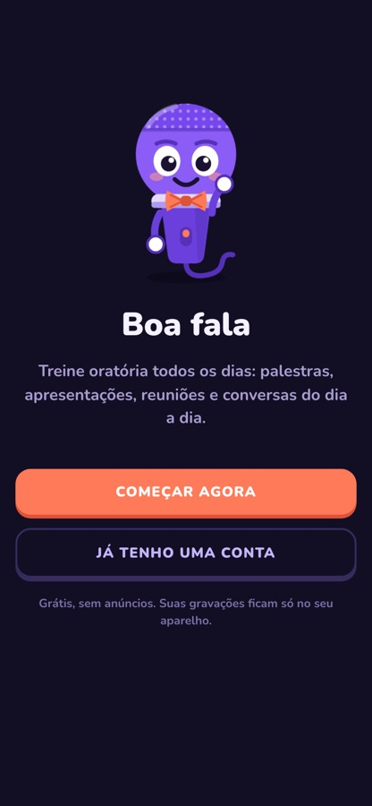
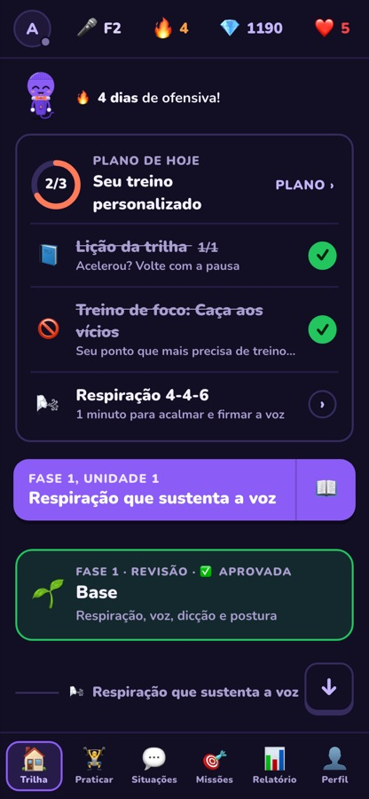
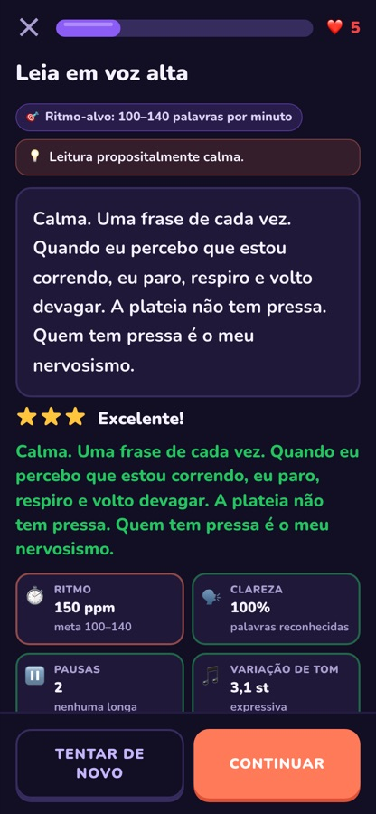
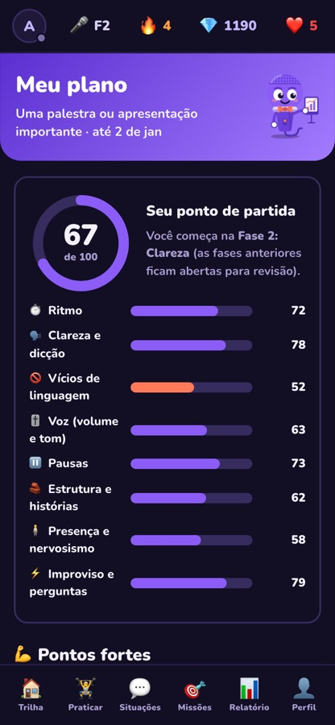
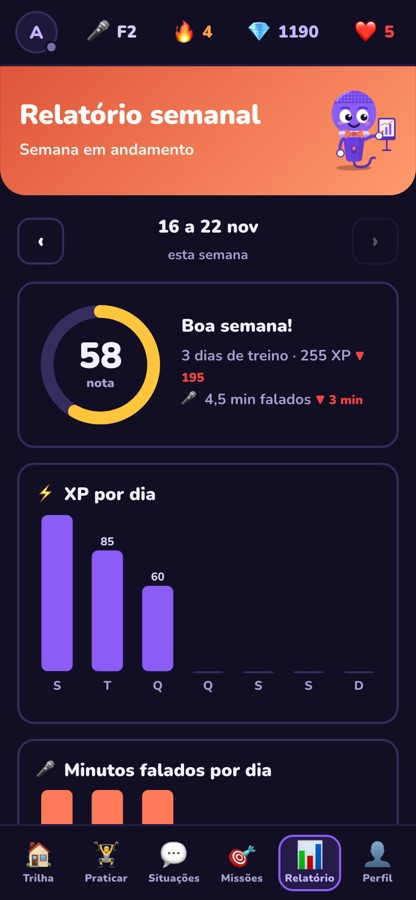
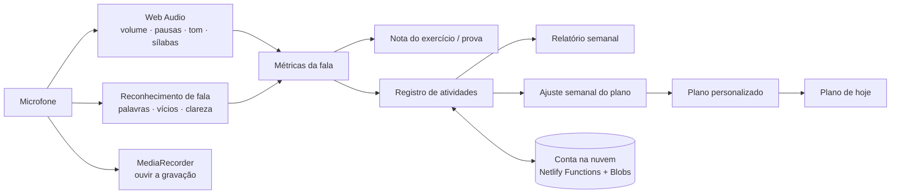

# Boa fala — app de oratória (estilo Duolingo)

> App gamificado para treinar oratória todos os dias: palestras, apresentações, pitch, reuniões e o dia a dia. Ele **escuta você falar** e mede, no próprio celular, ritmo, vícios de linguagem, pausas, clareza, volume e variação de tom. Criado por mim com IA (Claude Code), do conteúdo ao servidor de contas.

**🔗 App no ar:** https://boa-fala.netlify.app (instala no celular como app)
**👤 Autor:** Ricardo Gasparelo · [Portfólio](https://githubiogithubio.vercel.app) · [LinkedIn](https://www.linkedin.com/in/ricardo-gasparelo-212381380/)

*Prints com uma usuária fictícia de demonstração.*

---

## O problema

Falar bem em público se aprende praticando, mas quase ninguém tem quem ouça e dê retorno todos os dias. Cursos de oratória são caros e pontuais; apps de idioma não medem a sua fala em português.

## O que eu construí

| | |
|---|---|
| **Medição da fala no aparelho** | palavras por minuto (com medidor ao vivo), vícios como "né", "tipo", "é…", "então" (contador ao vivo e lista configurável), pausas e pausas longas, tempo até começar, clareza da leitura, volume e variação de tom em semitons |
| **Avaliação inicial** | necessidades (onde fala, o que trava, objetivo, prazo, tempo por dia, autoavaliação) + diagnóstico gravado: leitura, fala livre de 60 s, história de 90 s, projeção da voz e quiz de técnicas. No fim, a pessoa ouve a própria gravação |
| **Plano personalizado e adaptativo** | diagnóstico com números, pontos fortes e fracos, trilha reordenada pelo objetivo, pesos de treino por habilidade, rotina diária, marcos com datas honestas, aviso quando o ritmo não bate com o prazo, reavaliação e ajuste automático toda semana |
| **Trilha** | 6 fases (Base, Clareza, Presença, Persuasão, Palco, Maestria), **28 unidades e 84 lições**, incluindo situações do dia a dia (telefone, feedback, entrevistas, brinde). Cada fase termina com uma **prova gravada com critérios objetivos** (80% para passar) |
| **14 tipos de exercício** | trava-línguas com nota de clareza, leitura com ritmo-alvo, fala cronometrada, pausa estratégica, ênfase (detecta onde caiu o pico de força), montar o discurso, achar o erro, pergunta difícil com autoavaliação, espelho com câmera, respiração guiada 4-4-6 e mais |
| **Situações guiadas** | 12 conversas em que o app faz a outra pessoa com voz (plateia hostil, chefe pedindo status, cliente irritado, entrevista, brinde); a pessoa escolhe a melhor resposta e depois fala |
| **Gamificação** | ofensiva com congelamentos, vidas, gemas, missões diárias ("fale 3 minutos", "2 falas sem nenhum né"), conquistas, liga, loja e baús |
| **Relatório semanal** | nota, minutos falados, ritmo, vícios por minuto e quais mais aparecem, clareza, voz e tempo até começar, comparados com a semana anterior; o que foi bem, o que melhorar (com botão para o treino certo) e metas |
| **Conta na nuvem** | e-mail e senha (hash PBKDF2), código de recuperação, progresso sincronizado entre aparelhos e exclusão de conta |
| **Mascote próprio** | o **Mic**, um microfone de gravata-borboleta desenhado em SVG, com 13 expressões animadas |

## Decisões de produto

- **Custo zero e privacidade:** sem nenhuma API paga. A fala é analisada no próprio aparelho (Web Speech API e Web Audio API); as gravações nunca saem do celular.
- **Honestidade nas medidas:** o app explica que o reconhecimento de voz é uma aproximação. Quando ele falha, ritmo e pausas são estimados pelo som (picos de sílaba, calibrados com amostras reais).
- **Falas não custam vidas:** só as questões de conhecimento tiram vida, porque o reconhecimento de voz pode errar.
- **Previsões honestas:** o plano fala em "concluir a fase", com folga de 40% nas datas, e avisa quando o prazo não fecha.

## Como funciona por dentro

## Tecnologias

`HTML` `CSS` `JavaScript puro (sem framework)` `PWA / Service Worker` `Web Speech API` `Web Audio API (detecção de tom por autocorrelação)` `MediaRecorder` `IndexedDB` `Netlify Functions` `Netlify Blobs` `PBKDF2` `SVG animado` · construído com **Claude Code**

## Meu papel

Ideia, produto, conteúdo (84 lições escritas do zero), design, código, testes e publicação, tudo feito por mim usando IA como par de programação. Testei cada fluxo no navegador (avaliação com perfis diferentes, lições, provas, conversas, relatório e contas) e calibrei a medição com amostras de voz reais.

---

### Sobre o código

Este repositório é a **vitrine** do projeto. O código-fonte completo é privado. Se você é recrutador e quer ver o código ou uma demonstração, fale comigo no [LinkedIn](https://www.linkedin.com/in/ricardo-gasparelo-212381380/).

© 2026 Ricardo Friedrich Gasparelo. Todos os direitos reservados. Veja [LICENSE](LICENSE).
